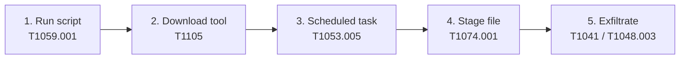

# 2. The plan

**Scenario:** an Amadey-style infection on my lab VM. The goal is to copy one dummy text file off the host. All actions are safe public tests; the file is fake data I create first.

**Setup (before step 1):** create the dummy file to "steal":
```
mkdir C:\ith-lab\loot
"line1,line2,line3`nfake test data for ITH week 8" | Out-File C:\ith-lab\loot\test-data.txt
```
Start the lab-local web server (e.g. `python -m http.server 8080` on the Elastic VM) for steps 2 and 5.

## The 5 steps

| # | Attacker step (Amadey) | ATT&CK | Test to use | Amadey link |
|---|---|---|---|---|
| 1 | User runs a script, PowerShell starts | T1204.002 + T1059.001 | Atomic T1059.001 (a PowerShell test that runs a command) | Emmenhtal → Amadey (Week 4 KC4) |
| 2 | Download the next stage from a server | T1105 | Atomic T1105 (`certutil` or PowerShell download from the lab web server) | Amadey pulls payloads/plugins (KC3/KC7) |
| 3 | Scheduled task every minute for persistence | T1053.005 | Atomic T1053.005 (`schtasks /SC MINUTE /MO 1`) | Amadey's every-minute task (KC5) |
| 4 | Collect and stage the file | T1005 + T1074.001 | Atomic T1074.001 (copy the file to a staging folder) | StealC collects data (KC7) |
| 5 | Send the file to the server | T1041 / T1048 | Atomic T1048.003 or a CALDERA exfil ability (HTTP POST the file to the lab web server) | StealC exfiltrates to its C2 (KC7) |

Each step: pick the concrete Windows test as in Week 9 (`Invoke-AtomicTest <ID> -ShowDetailsBrief`), set any URL/path input to the lab server and `C:\ith-lab\loot\test-data.txt`, run it, run its cleanup at the end.

## As a CALDERA profile

The same five techniques as an adversary profile (abilities in this order): Command and Scripting Interpreter (T1059.001) → Ingress Tool Transfer (T1105) → Scheduled Task (T1053.005) → Local Data Staging (T1074.001) → Exfiltration Over C2 / Alternative Protocol (T1041 / T1048.003). Run as one operation against the lab agent. CALDERA has built-in abilities for all five.

## Flow



Initial access/execution → persistence → exfiltration, which is exactly the chain the syllabus asks for.
